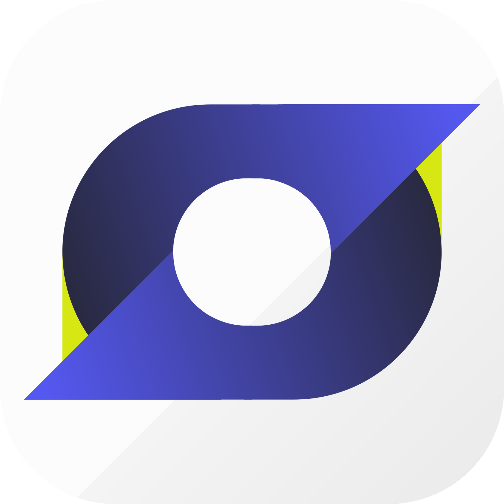
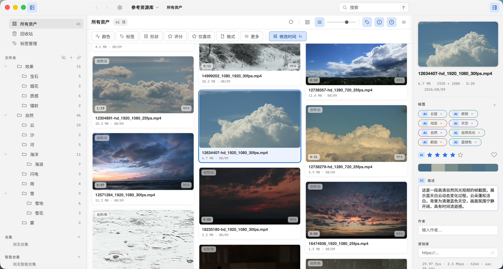

<div align="center">

**🇺🇸 English** | [🇨🇳 简体中文](README.md)

</div>

# Serpent

<div align="center">



</div>

Open-source (MIT), cross-platform (macOS / Windows / Linux) digital asset manager for game artists, film and post-production teams, and designers.

[Homepage](https://serpent.dolag.work) · [Online docs](https://serpent.dolag.work/docs/user-guide/) · [Latest release](https://github.com/dolag233/Serpent/releases) · [Browser extension](https://github.com/dolag233/Serpent-Extension/releases)

Import, browse, search, tag, collect, preview 3D models (FBX/OBJ/GLB and more), and render with HDRI environment lighting and PBR. Data stays in a local library — no cloud dependency.

## Features

+ **Massive asset support.** Most video, image, and audio formats, plus 3D models and text assets.
+ **Asset management.** Tags, ratings, descriptions, fast filtering and search, and collections.
+ **Workspace tabs.** Keep several folders, collections, or searches open at once, each with its own place, query, and selection.
+ **Plugin system.** Extend Serpent with plugins.
+ **Scripting & MCP.** Control Serpent with scripts, and let agents connect and automate through MCP.
+ **AI analysis.** Built-in AI module analyzes images, videos, and 3D assets.
+ **New UI.** Appearance settings switch between the New UI and the legacy layout, and can edit themes plus background and panel opacity.
+ **Semantic search (experimental).** Find images and text by meaning, and find similar assets.
+ **WebDAV cloud sync.** Two-way library sync across machines, with auto-sync and a configurable poll interval.
+ **Browser extension:** [Serpent-Extension](https://github.com/dolag233/Serpent-Extension) supports batch saving web media, capturing webpage screenshots, and saving some hotlink-protected media through the browser session.
+ **External libraries.** Open Eagle / Billfish libraries directly and browse and search them seamlessly after conversion.

<div align="center">



</div>

## Install

Download the latest release package from [GitHub Releases](https://github.com/dolag233/Serpent/releases).

**macOS**: download `Serpent-darwin-arm64-<version>-package.dmg` (or portable `.zip`) and drag Serpent into Applications. On first launch, if macOS prompts "cannot verify the developer", right-click the app → select Open (first time only), or run:

```bash
xattr -cr /Applications/Serpent.app
```

**Windows**: download the installer package `Serpent-win-x86-64-<version>-setup.zip` (extract and run the included installer), or download the portable version `Serpent-win-x86-64-<version>-portable.zip` (extract and run directly). Unsigned builds show a SmartScreen warning on first run — choose "More info → Run anyway".

**Linux**: download `Serpent-linux-x86-64-<version>.AppImage`, `chmod +x`, then run. Needs FUSE (`libfuse2`); without FUSE use `--appimage-extract-and-run`. The package includes `ffmpeg`, `ffprobe`, and `oiiotool`, so video and professional-image previews do not depend on the system PATH. `SERPENT_FFMPEG_PATH` / `SERPENT_OIIO_PATH` can still point at another copy.

**Browser extension**: download it from the [browser extension releases](https://github.com/dolag233/Serpent-Extension/releases). See the [Browser Extension User Guide](docs/user-guide/browser-extension.en.md) for installation and setup instructions.

## Build locally

Requires Node.js 24.15.0 (see `.nvmrc`). Native development targets are macOS arm64, Windows x64, and Linux x64. Do not build from an SMB/NAS-mounted path.

```bash
npm ci --registry=https://registry.npmjs.org
npm run rebuild:native   # align better-sqlite3 with Electron's ABI (verifies FTS5)
npm start
```

Common commands:

```bash
npm run lint             # ESLint
npm run typecheck        # tsc --noEmit
npm run test             # unit + worker integration tests
npm run test:e2e         # Playwright E2E
npm run package          # package to out/Serpent-<platform>-<arch>/
npm run make             # build platform installers (macOS dmg / Windows zip; Linux via make:appimage)
```

The full build, packaging and release flow is in the [developer docs](docs/developer/build-packaging.en.md).

### Linux (x64 / arm64)

Linux follows the Windows-style shell: a frameless window with Serpent's own title bar (minimize / maximize / close, drag, double-click to maximize, edge resize), the in-app main menu (≡) instead of a native menu bar, and Windows 11-style rounded corners when a compositor is running (square corners otherwise).

Differences from Windows (current implementation):

- **No system tray**: the close button quits the app (it does not hide to the notification area like on Windows).
- **Media tools**: `npm start` does not ship a media bundle. Until `media:ensure` has run, it uses `ffmpeg` / `ffprobe` / `oiiotool` from `PATH` (`SERPENT_FFMPEG_PATH` / `SERPENT_OIIO_PATH` override). The linux-x64 pinned bundle is ready in `bundle-lock.json` and is packed into the release AppImage. linux-arm64 uses the same path, but its zip is not promoted yet, so a release package cannot be produced.
- **Display**: tested on Debian 13 (X11 / xfwm4) and under a nested Wayland compositor; native Wayland sessions still need dedicated acceptance — day-to-day use is X11 / XWayland. x86_64 and aarch64 share this.

Prerequisites (Debian/Ubuntu):

```bash
sudo apt install build-essential python3 ffmpeg    # compiler for better-sqlite3; system ffmpeg/ffprobe for npm start before the media bundle is acquired
# optional for that dev run: openimageio-tools (oiiotool) for EXR/RAW/PSD and other pro image formats
```

Then use Node.js 24.15.0 and the same commands as above (`npm ci`, `npm run rebuild:native`, `npm start`).

Environment switches:

| Variable | Effect |
| --- | --- |
| `SERPENT_SOFTWARE_GL=1` | Software WebGL (SwiftShader) for machines with no usable GPU / GL driver (VMs, remote desktops), so the 3D viewer can render |
| `SERPENT_LINUX_ROUNDED_CORNERS=0` / `1` | Force square / rounded window corners (the default is auto: rounded only when a compositor is running) |

#### AppImage (Linux)

```bash
npm run make:appimage           # host build → out/make/appimage/Serpent-<version>-x86_64.AppImage or -aarch64.AppImage
npm run make:appimage:docker    # Ubuntu 22.04 (glibc 2.35 baseline); container arch follows the host; needs docker
chmod +x out/make/appimage/Serpent-*.AppImage && ./out/make/appimage/Serpent-*.AppImage
```

The release pipeline `npm run release:make` prefers `make:appimage:docker` and renames the artifact to `Serpent-linux-x86-64-<version>.AppImage` or `Serpent-linux-arm64-<version>.AppImage` (same naming contract as macOS/Windows assets). Both architectures share the glibc baseline, FUSE requirement, and X11/Wayland limits. aarch64 cannot produce a release package until its media zip is promoted.

The release AppImage bundles the pinned media tools (`ffmpeg` / `ffprobe` / `oiiotool`) and does not require them on the system PATH. `SERPENT_FFMPEG_PATH` / `SERPENT_OIIO_PATH` still override. Running it needs FUSE (`libfuse2`); without FUSE use `--appimage-extract-and-run`. When unprivileged user namespaces are unavailable (some containers; Ubuntu 24.04 AppArmor policy), the launcher falls back to `--no-sandbox`.

## Documentation

| Doc | Content |
| --- | --- |
| [User guide](docs/user-guide/README.en.md) | Install, import, browse, search (including experimental semantic search), New UI, tags, collections, 3D viewer, troubleshooting |
| [Online docs](https://serpent.dolag.work/docs/user-guide/) | The latest user guide in your browser |
| [Developer docs](docs/developer/README.en.md) | Setup, build & packaging, architecture, testing |
| [Contributing Guide](docs/developer/contributing.en.md) | Open source collaboration, environment setup, and Pull Request workflow |
| [Extension author manual](docs/manual/README.md) | Plugins / scripts / MCP |
| [Product brief](docs/product-brief.md) | Product vision and MVP scope |

## License

MIT. Bundled media components and assets carry their own licenses (FFmpeg LGPL, OpenImageIO, ufbx MIT, Poly Haven CC0) — see the LICENSE files under each `resources/` directory.
