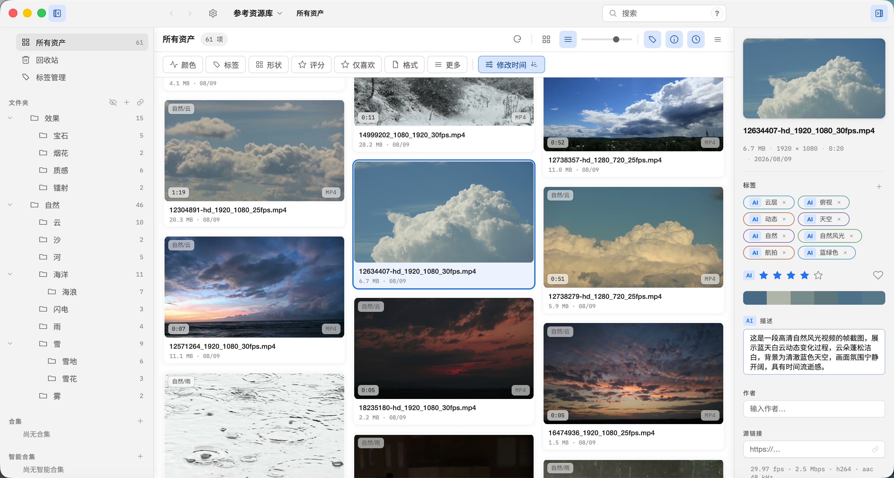

<div align="center">

[🇺🇸 English](README.en.md) | **🇨🇳 简体中文**

</div>

# Serpent

<div align="center">


</div>

开源（MIT）、跨平台（macOS / Windows / Linux）的数字资产管理软件，面向游戏美术、影视后期、平面/动态图形设计师。

主页：[serpent.dolag.work](https://serpent.dolag.work) · [在线文档](https://serpent.dolag.work/docs/user-guide/) · [下载最新版本](https://github.com/dolag233/Serpent/releases) · [浏览器扩展](https://github.com/dolag233/Serpent-Extension/releases)

## 特性

+ 支持**海量**资产类型。支持大多数视频、图像、音频格式。额外支持3D模型、文本类型资产。
+ 资产管理系统。支持对资产添加标签、打分、添加描述等功能。支持快速过滤和搜索。支持添加合集。
+ 支持工作区标签页。可同时打开多个文件夹、合集或搜索，各自保留浏览位置、搜索和选择。
+ 支持插件系统。支持用插件扩展Serpent功能。
+ 支持脚本、MCP调用。支持使用脚本控制Serpent。支持Agent通过MCP连接、控制Serpent，以实现自动化管理。
+ 支持AI分析。内置AI分析模块，支持对图像、视频、3D资产进行AI分析。
+ 支持全新 UI。外观设置可在全新 UI 与旧版布局之间切换，并可编辑主题、背景和面板不透明度。
+ 支持语义搜索（实验性）。可按含义查找图片和文本，并查找相似资产。
+ 支持WebDAV云同步。多台设备间双向同步资源库，支持自动同步与可配置的轮询间隔。
+ 完备的浏览器扩展。[Serpent-Extension](https://github.com/dolag233/Serpent-Extension) 支持批量下载、优先保存原始媒体（不可用时回退到预览内容）和网页截图。
+ 支持打开外部资源库。可直接打开 Eagle / Billfish 资源库，转换后无缝浏览与检索。

<div align="center">



</div>

## 安装

从 [GitHub Releases](https://github.com/dolag233/Serpent/releases) 下载最新安装包。

**macOS**：下载 `Serpent-darwin-arm64-<版本>-package.dmg`（或便携版 `.zip`），将 Serpent 拖入「应用程序」。首次打开时 macOS 若提示"无法验证开发者"，右键点击应用 → 选择「打开」（仅首次），或在终端执行：

```bash
xattr -cr /Applications/Serpent.app
```

**Windows**：下载安装包 `Serpent-win-x86-64-<版本>-setup.zip`（解压运行内含的安装程序），或下载便携版 `Serpent-win-x86-64-<版本>-portable.zip`（解压即用）。未签名版本首次运行会显示 SmartScreen 警告，选择「更多信息 → 仍要运行」。

**Linux**：下载 `Serpent-linux-x86-64-<版本>.AppImage`，`chmod +x` 后运行。需要 FUSE（`libfuse2`）；无 FUSE 时加 `--appimage-extract-and-run`。安装包内带 `ffmpeg`、`ffprobe` 和 `oiiotool`，视频与专业图像预览不依赖系统 PATH。仍可用 `SERPENT_FFMPEG_PATH` / `SERPENT_OIIO_PATH` 改用其他路径。

**浏览器扩展**：从[浏览器扩展发布页](https://github.com/dolag233/Serpent-Extension/releases)下载。安装与配置指引见[浏览器扩展使用指南](docs/user-guide/browser-extension.md)。

## 本地构建

要求 Node.js 24.15.0（见 `.nvmrc`）。原生开发目标为 macOS arm64、Windows x64 与 Linux x64。不要在 SMB/NAS 挂载目录上构建。

```bash
npm ci --registry=https://registry.npmjs.org
npm run rebuild:native   # 对齐 better-sqlite3 与 Electron ABI（校验 FTS5）
npm start
```

常用命令：

```bash
npm run lint             # ESLint
npm run typecheck        # tsc --noEmit
npm run test             # 单元 + Worker 集成测试
npm run test:e2e         # Playwright E2E
npm run package          # 打包到 out/Serpent-<platform>-<arch>/
npm run make             # 按平台生成安装包（macOS dmg / Windows zip；Linux 用 make:appimage）
```

完整的构建、打包、发布流程见[开发者文档](docs/developer/build-packaging.md)。

### Linux（x64 / arm64）

Linux 沿用 Windows 风格的界面：无边框窗口 + Serpent 自绘标题栏（最小化 / 最大化 / 关闭、拖动、双击最大化、边缘缩放），用应用内主菜单（≡）代替原生菜单栏；有合成器时显示 Windows 11 风格圆角，没有合成器时自动退回直角。

与 Windows 的差异（当前实现）：

- **无系统托盘**：关闭按钮会退出应用（不会像 Windows 那样隐藏到通知区域）。
- **媒体工具**：`npm start` 不会自带媒体包。未执行 `media:ensure` 时，从 `PATH` 使用 `ffmpeg` / `ffprobe` / `oiiotool`（可用 `SERPENT_FFMPEG_PATH` / `SERPENT_OIIO_PATH` 覆盖）。linux-x64 的 pinned bundle 已在 `bundle-lock.json` 中就绪，并打进发布用 AppImage。linux-arm64 使用同一路径，但 zip 尚未晋升，发不出现成包。
- **显示协议**：已在 Debian 13（X11 / xfwm4）和嵌套 Wayland 合成器下测试；原生 Wayland 会话仍待专项验收，日常以 X11 / XWayland 为主。x86_64 与 aarch64 相同。

依赖（Debian/Ubuntu）：

```bash
sudo apt install build-essential python3 ffmpeg    # better-sqlite3 需要编译器；未取得媒体包时，npm start 的视频/音频需要系统 ffmpeg/ffprobe
# 可选：同一开发运行下的 openimageio-tools（oiiotool），用于 EXR/RAW/PSD 等专业图像格式
```

然后用 Node.js 24.15.0 执行上面的命令（`npm ci`、`npm run rebuild:native`、`npm start`）。

环境变量：

| 变量 | 作用 |
| --- | --- |
| `SERPENT_SOFTWARE_GL=1` | 没有可用 GPU / GL 驱动（虚拟机、远程桌面）时启用软件 WebGL（SwiftShader），让 3D 查看器能渲染 |
| `SERPENT_LINUX_ROUNDED_CORNERS=0` / `1` | 强制直角 / 圆角（默认自动：有合成器才用圆角） |

#### AppImage（Linux）

```bash
npm run make:appimage           # 在本机构建 → out/make/appimage/Serpent-<version>-x86_64.AppImage 或 -aarch64.AppImage
npm run make:appimage:docker    # 在 Ubuntu 22.04（glibc 2.35 基线）中构建，容器架构跟随宿主机，需要 docker
chmod +x out/make/appimage/Serpent-*.AppImage && ./out/make/appimage/Serpent-*.AppImage
```

发布管线 `npm run release:make` 会优先 `make:appimage:docker`，并把产物重命名为 `Serpent-linux-x86-64-<version>.AppImage` 或 `Serpent-linux-arm64-<version>.AppImage`（与 macOS/Windows 资产命名一致）。两条架构的 glibc 基线、FUSE 和 X11/Wayland 限制相同。aarch64 要等媒体 zip 晋升后才能打出发布包。

发布用 AppImage 内置 pinned 媒体工具（`ffmpeg` / `ffprobe` / `oiiotool`），不要求这些程序已经在系统 PATH 上。`SERPENT_FFMPEG_PATH` / `SERPENT_OIIO_PATH` 仍可覆盖。运行需要 FUSE（`libfuse2`）；没有 FUSE 时加 `--appimage-extract-and-run`。系统不允许非特权 user namespace 时（部分容器、Ubuntu 24.04 的 AppArmor 策略），启动器会自动改用 `--no-sandbox`。

## 文档

| 文档 | 内容 |
| --- | --- |
| [使用手册](docs/user-guide/README.md) | 安装、导入、浏览、搜索（含实验性语义搜索）、全新 UI、标签、合集、3D 查看、故障排查 |
| [在线文档](https://serpent.dolag.work/docs/user-guide/) | 浏览器中阅读最新使用手册 |
| [开发者文档](docs/developer/README.md) | 环境搭建、构建打包、架构、测试 |
| [贡献指南](docs/developer/contributing.md) | 开源协作准则、环境准备与 Pull Request 流程 |
| [扩展作者手册](docs/manual/README.md) | 插件 / 脚本 / MCP |
| [产品简报](docs/product-brief.md) | 产品愿景与 MVP 边界 |

## 许可证

MIT。内置媒体组件与资产遵循各自许可（FFmpeg LGPL、OpenImageIO、ufbx MIT、Poly Haven CC0），见各 `resources/` 目录的 LICENSE 文件。
