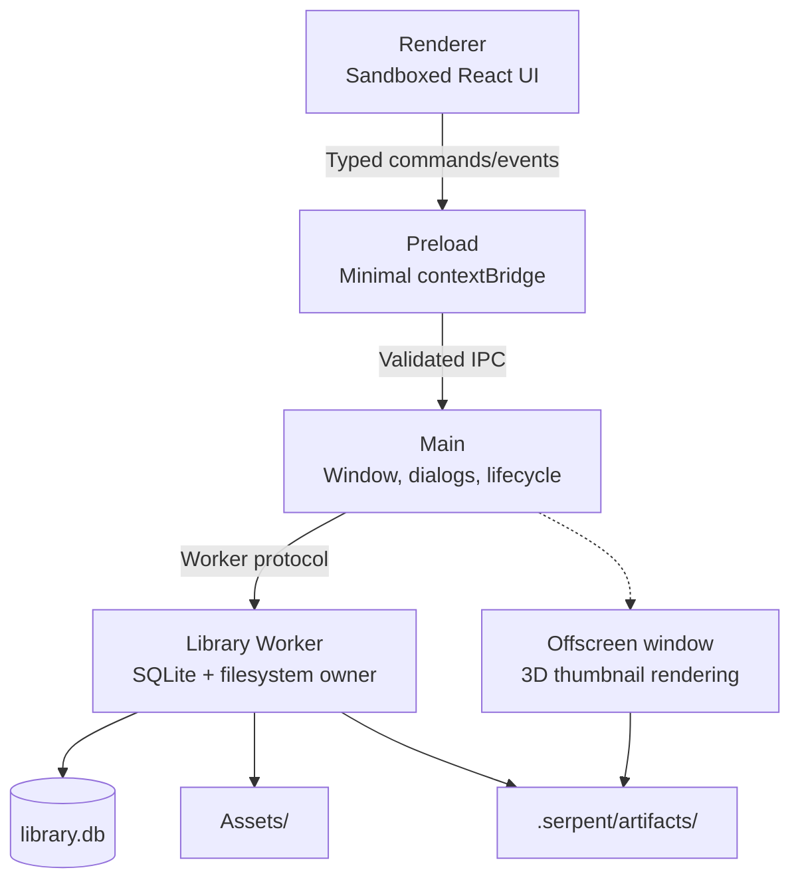

# Architecture

## Process model

```
Renderer (sandboxed, no Node)
  │ typed commands/events only
  ▼
Preload (minimal bridge, contextIsolation)
  ▼
Main (window + dialogs + process lifecycle)
  ▼
Library Worker (UtilityProcess; filesystem + SQLite owner)
```



Invariants:

- The Renderer never gets arbitrary path or SQL capabilities
- Main never opens the library database or scans asset directories
- The Library Worker is the sole owner of the database and file operations
- All cross-process I/O is validated with Zod at runtime

A hidden offscreen window (owned by Main) renders 3D model thumbnails.

After an unexpected Library Worker exit, Main makes bounded restart attempts and reopens previously known libraries. New requests wait behind the recovery gate. A normal shutdown does not trigger recovery; repeated crashes stop retries and report failure. Restoring a library session does not replay interrupted file operations, so callers still need to check their outcomes.

## Tech stack

Electron + TypeScript + SQLite (better-sqlite3, FTS5) + Vite + React. Packaging via electron-forge + Vite multi-entry (main / preload / offscreen / worker / script runtimes).

## Directory layout

```
src/
├── main/          # Electron main: windows, dialogs, lifecycle, custom protocols
├── preload/       # contextBridge
├── renderer/      # React renderer
├── worker/        # Library Worker: SQLite, filesystem, import/search/thumbnail pipelines
├── scripting/     # script runtime and plugin hosts
├── shared/        # cross-process: protocols, types, validation schemas
└── automation/    # automation Gateway / MCP
scripts/           # build, media, packaging, release scripts
resources/         # runtime resources (media binaries, ufbx WASM, icons)
tests/
├── unit/          # pure unit tests (Node ABI)
├── worker/        # worker integration tests (Electron ABI)
└── e2e/           # Playwright E2E (dev and packaged)
docs/              # documentation (this tree, ADRs, specs, QA)
```

## Data layer

- Each library is one SQLite database (`.serpent/library.db`) with versioned schema migrations through `MIGRATIONS`
- Asset files live in `Assets/`; derived data (thumbnails/proxies) in `.serpent/artifacts/`
- **Data-compatibility discipline**: migrations are add-only (no dropping/renaming existing tables, columns, indexes or triggers); new builds must open old libraries (lenient reads — missing columns degrade to defaults, never crash); Desktop does not offer read-only libraries — damage is repaired from backups then Assets rescue. Library availability is the hardest baseline: any library-related change must fully run `npm run test:library-availability`. See [ADR-0028](https://github.com/dolag233/Serpent/blob/dolag_dev/docs/internal/adr/0028-schema-compatibility-read-only-degrade.md) and [0031](https://github.com/dolag233/Serpent/blob/dolag_dev/docs/internal/implementation/0031-schema-compatibility-guarantee.md)

## Media pipeline

- Thumbnails / video proxies / audio proxies: Worker queues → Main/child processes (FFmpeg/OIIO) → written back to artifacts
- FBX: ufbx WASM conversion → GLB (cached) → rendered via GLTFLoader
- 3D thumbnails: Worker queues → Main offscreen window renders → PNG written back

RAW thumbnails and viewer images are separate artifacts: a thumbnail may come from a bounded embedded JPEG, while the viewer image still requires a full decode. RAW viewer images currently use JPEG; consumers must not assume every `viewer_image` is PNG. Verify ARW camera-preview tone matching separately from the default path for other RAW formats. See the [media format guide](media-format-support.en.md).

## Search contract

Toolbar, script, and plugin text queries share `src/shared/search-expression.ts`, with `search` and `tags` contexts. Space is AND, `|` is OR, `-` is NOT, and parentheses group conditions. `tag:` matches substrings, `tag=` matches complete tags, and bare names in the tags context match complete tags. Text parsing allows 512 characters, 32 terms, and 8 nested groups. Invalid UI input retains the last valid results; invalid automation input returns a parameter error.

Cross-process queries use the versioned expression tree in `src/shared/asset-types.ts`: `{ clauses: [], expression: { version: 1, root } }`. Nodes are `TERM` / `AND` / `OR` / `NOT`; `exact_tag` is only valid for the `tags` field. Legacy `clauses` / `groups` retain their meanings but cannot be mixed with `expression`. Optional `expressionSource` preserves editing text and requires an expression. Structured trees have a separate budget of 63 nodes and depth 16.

Tag conditions use a filter with `field: 'tag_expression'` and `exclude: false`. Its tree can only contain tag terms, with exclusion represented by `NOT`. MCP accepts structured queries directly. Main normalizes the string form used by script and plugin `assets.search({ query: string | null })`. All entry points must retain the same schema validation and Worker search execution. See the [MCP API](../manual/mcp/api-reference.md#搜索) and [script API](../manual/scripts/api-reference.md#assetssearchinput) for calls.

## Extension system

Plugins (sandboxed UI + Host API), automation scripts (isolated QuickJS), and MCP (Desktop-embedded loopback Streamable HTTP) — see the [extension author manual](../manual/README.md).

## Key design decisions

- Process isolation and least privilege: no Node in the Renderer, Main never touches the database
- Data compatibility is a release-level gate (Serpent-033e / ADR-0028 / 0031)
- Native-platform builds only (no cross-packaging); the release pipeline carries end-to-end gates
