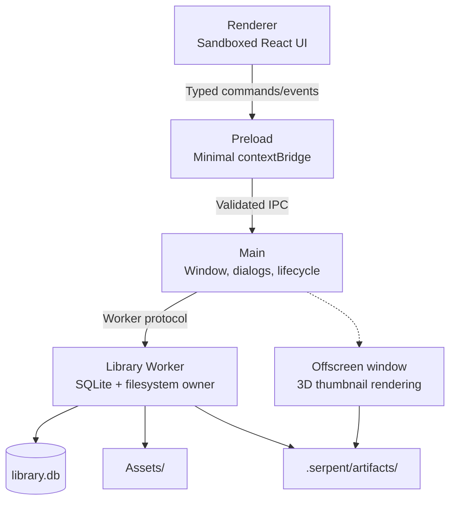

# 架构

## 进程模型

```
Renderer (sandboxed, no Node)
  │ typed commands/events only
  ▼
Preload (minimal bridge, contextIsolation)
  ▼
Main (window + dialogs + process lifecycle)
  ▼
Library Worker (UtilityProcess; filesystem + SQLite owner)
```



不变量：

- Renderer 永远不接收任意路径读写或 SQL 能力
- Main 不打开资源库数据库、不扫描资产目录
- Library Worker 是数据库与文件操作的唯一所有者
- 所有跨进程 I/O 经 Zod 运行时校验

另有一个隐藏 offscreen 窗口（Main 持有），用于 3D 模型缩略图离屏渲染。

Library Worker 意外退出时，Main 会有限重试启动进程并重新打开此前已知的资源库；恢复中的新请求等待恢复完成后再进入 Worker。正常关闭不触发恢复，反复崩溃会停止重试并报告失败。恢复库会话不等于自动重放已中断的文件操作，调用方仍需检查操作结果。

## 技术栈

Electron + TypeScript + SQLite（better-sqlite3，FTS5）+ Vite + React。构建用 electron-forge + Vite 多入口（main / preload / offscreen / worker / 脚本运行时）。

## 目录结构

```
src/
├── main/          # Electron 主进程：窗口、对话框、进程生命周期、自定义协议
├── preload/       # contextBridge 桥
├── renderer/      # React 渲染器
├── worker/        # Library Worker：SQLite、文件操作、导入/搜索/缩略图管线
├── scripting/     # 脚本运行时与插件 Host
├── shared/        # 跨进程共享：协议、类型、校验 schema
└── automation/    # 自动化 Gateway / MCP
scripts/           # 构建、媒体、打包、发布脚本
resources/         # 运行时资源（媒体二进制、ufbx WASM、图标）
tests/
├── unit/          # 纯单元测试（Node ABI）
├── worker/        # Worker 集成测试（Electron ABI）
└── e2e/           # Playwright E2E（dev 与 packaged）
docs/              # 文档（本目录、ADR、实施规格、QA）
```

## 数据层

- 每个资源库一个 SQLite 数据库（`.serpent/library.db`），schema 通过 `MIGRATIONS` 版本化迁移
- 资产文件存 `Assets/`，派生数据（缩略图/代理）存 `.serpent/artifacts/`
- **数据兼容纪律**：迁移只加不改（禁删改现有表/列/索引/触发器）；新代码必须能打开旧库（宽容读取：缺列降级默认值，不崩溃）；Desktop 不提供只读资源库，损坏走备份再 Assets 抢救。资源库可用性是项目最重要底线，相关改动必须完整跑完 `npm run test:library-availability`。见 [ADR-0028](https://github.com/dolag233/Serpent/blob/dolag_dev/docs/internal/adr/0028-schema-compatibility-read-only-degrade.md) 与 [0031](https://github.com/dolag233/Serpent/blob/dolag_dev/docs/internal/implementation/0031-schema-compatibility-guarantee.md)

## 媒体管线

- 缩略图/视频代理/音频代理：Worker 排队 → Main/子进程处理（FFmpeg/OIIO）→ 写回 artifacts
- FBX：ufbx WASM 转换 → GLB（缓存）→ GLTFLoader 渲染
- 3D 缩略图：Worker 入队 → Main offscreen 窗口渲染 → PNG 写回

RAW 的缩略图和查看图是独立产物：缩略图可以来自有界的内嵌 JPEG，查看图仍需完整解码。当前 RAW 查看图是 JPEG，不能假设所有 `viewer_image` 都是 PNG。ARW 的相机预览明暗参考与其他 RAW 的默认解码路径也须分别验证，见[媒体格式支持指南](media-format-support.md)。

## 搜索契约

工具栏、脚本和插件的文本查询共用 `src/shared/search-expression.ts`；搜索与标签条件分别使用 `search`、`tags` 上下文。空格是 AND，`|` 是 OR，`-` 是 NOT，括号分组；`tag:` 包含匹配，`tag=` 完整标签匹配，标签上下文的裸名称默认完整匹配。文本解析预算为 512 字符、32 个词项、8 层括号。界面无效输入保留上次有效结果；自动化无效输入返回参数错误。

跨进程查询使用 `src/shared/asset-types.ts` 的版本化表达式树：`{ clauses: [], expression: { version: 1, root } }`。节点为 `TERM` / `AND` / `OR` / `NOT`；`exact_tag` 只允许 `tags` 字段。旧 `clauses` / `groups` 保留原有语义，但不能与 `expression` 混用。可选 `expressionSource` 只用于保留编辑文字，必须与表达式同时存在。结构化树另受 63 节点、16 层深度约束。

标签组合条件使用 `field: 'tag_expression'` 的过滤项，`exclude` 必须为 `false`，树中只能包含标签词项；排除通过 `NOT` 表达。MCP 直接接收结构化查询，脚本和插件的 `assets.search({ query: string | null })` 由 Main 归一化；各入口必须继续经过同一套 Schema 与 Worker 搜索执行。调用示例见[MCP API](../manual/mcp/api-reference.md#搜索)和[脚本 API](../manual/scripts/api-reference.md#assetssearchinput)。

## 扩展体系

- 插件（sandboxed UI + Host API）、自动化脚本（QuickJS 隔离）、MCP（Desktop 内嵌 loopback Streamable HTTP）——详见[扩展作者手册](../manual/README.md)

## 关键设计决策

- 进程隔离与最小权限：Renderer 无 Node、Main 不碰数据库
- 数据兼容为发布级门禁（Serpent-033e / ADR-0028 / 0031）
- 平台原生构建（无交叉打包），发布流水线带全链路门禁
