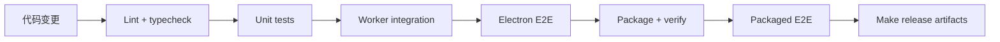

# 构建与打包

## 基础命令

```bash
npm run package          # 打包应用（含构建）→ out/Serpent-<platform>-<arch>/
npm run make             # 生成安装包 → out/make/（macOS dmg / Windows zip；Linux 用 npm run make:appimage）
npm run verify:package   # 校验打包产物（ASAR、native 模块、媒体组件）
```

`package`/`make` 的 prepackage/premake 钩子会先确保媒体依赖可用：

- 媒体二进制（`media-binaries ensure`，必要时从锁定 release 恢复后校验来源与哈希）
- ufbx WASM 产物（`verify-ufbx-wasm`，哈希锁 `scripts/ufbx-wasm-lock.json`）
- 打包产物完整性（`verify:package`：ASAR、better_sqlite3.node、Host utilities）

`package`/`make` 会更新 dev 的 Electron binary，跑完执行 `npm run rebuild:native` 恢复。

如果媒体可执行文件缺失，或本地文件与已晋升的 manifest 不一致，钩子会自动从
锁定的 `Serpent-Build` release 下载并重新校验。也可以手动执行同一流程：

```bash
npm run media:ensure
```

离线环境可设置 `SERPENT_MEDIA_AUTO_ACQUIRE=0`，此时校验失败会直接报错，不会联网下载。

## 发布流水线（release:local）

一键全流程：

```bash
npm run release:local
```

阶段：`verify` → `media` → `package` → `e2e` → `make` → `checksums`

| 阶段 | 内容 |
| --- | --- |
| verify | `rebuild:native` + `verify:mainline`（与 CI 相同门禁） |
| media | 从受控 URL 下载媒体包（`media:acquire`）+ 校验；linux-x64 与 linux-arm64 都与 macOS/Windows 走同一门禁（linux-arm64 在 bundle 晋升前为 `build-required`） |
| package | `electron-forge package` + `verify:package` |
| e2e | 对打包产物跑启动测试（`test:e2e:packaged`） |
| make | 生成安装包（Linux：优先 `make:appimage:docker`，并重命名为 `Serpent-linux-x86-64-<ver>.AppImage` 或 `Serpent-linux-arm64-<ver>.AppImage`） |
| checksums | 产物 SHA-256 manifest（带版本头） |

跳过慢阶段的选项：`--skip-verify` / `--skip-media` / `--skip-e2e`。单独跑某阶段：`npm run release:<phase>`（e2e 阶段为 `npm run release:e2e:packaged`）。



### 本地试跑（无媒体晋升时）

媒体包需先"晋升"（构建产物登记进 `bundle-lock.json` 的不可变 URL + 哈希）才能走正式流水线。本地已有匹配 `source-lock.json` 的产物时，跳过 provenance 校验：

```bash
SERPENT_MEDIA_SKIP_PROVENANCE=1 npm run release:local -- --skip-verify --skip-media
```

> `SKIP_PROVENANCE` 只用于本地试跑，正式发布必须走晋升流程。

另一条本地路径是 `--build-media-locally`：在本机用 vcpkg 完整构建媒体组件（`scripts/media-build/*`，耗时 1-3 小时）后自动以本地产物放行门禁：

```bash
npm run release:local -- --skip-verify --build-media-locally
```

### 版本

- 版本号在 `package.json`，semver 格式
- 提升：`npm version patch|minor|major`（自动打 tag）
- 每次流水线运行输出 `Serpent v<版本>`；checksum manifest 带版本头

### 平台

`forge.config.ts` 强制**原生平台构建**——pinned media 白名单为 `darwin-arm64` / `win32-x64` / `linux-x64` / `linux-arm64`；Linux 也必须在本机（或同架构的 `make:appimage:docker` 容器内）打包，不支持交叉打包。各平台各自跑同一发布流水线。

### Linux AppImage

```bash
npm run make:appimage           # 本机 → out/make/appimage/Serpent-<ver>-x86_64.AppImage 或 Serpent-<ver>-aarch64.AppImage
npm run make:appimage:docker    # Ubuntu 22.04 / glibc 2.35 基线，容器架构跟随宿主机（推荐发布构建）
npm run release:make            # 优先 docker，并重命名为 Serpent-linux-x86-64-<ver>.AppImage 或 Serpent-linux-arm64-<ver>.AppImage
```

- linux-x64 与 linux-arm64 都内置与 macOS/Windows 相同的 pinned media bundle（`ffmpeg` / `ffprobe` / `oiiotool`）。`package` 的 `prePackage` 会执行 `media:ensure`。`bundle-lock.json` 里 linux-x64 目前为 `ready`。linux-arm64 仍是 `build-required`：`media-v0.1.2` 没有 `serpent-media-linux-arm64.zip`，在原生 aarch64 上跑 `scripts/media-build/linux-arm64.sh`、上传 zip 并写回 URL 与 SHA-256 之前，`media:acquire` 会失败，发不出现成 AppImage。本地试跑可用 `SERPENT_MEDIA_SKIP_PROVENANCE=1` 或 `--build-media-locally`。
- Linux media bundle 必须在 `ubuntu:22.04` 容器内用 `scripts/media-build/linux-*.sh` 构建（系统自带 GCC），保证 `ffmpeg`/`ffprobe`/`oiiotool` 最高只依赖 GLIBC 2.35，与 AppImage 的 22.04 基线一致；发布前用 `objdump -T <bin> | grep -o 'GLIBC_[0-9.]*' | sort -uV | tail -1` 核对。linux-x64 当前为 `media-v0.1.3`（22.04 重建，源与配置同 `media-v0.1.2`）。
- glibc 基线与 x86_64 相同（Ubuntu 22.04 / 2.35）。需要 FUSE（`libfuse2`）；无 FUSE 时 `--appimage-extract-and-run`。X11 / Wayland 限制与 x86_64 相同。
- Release 上传名与应用内更新器一致：`Serpent-linux-x86-64-<ver>.AppImage` 或 `Serpent-linux-arm64-<ver>.AppImage`（另附同名 `.sha256`）。校验清单为 `SHA256SUMS-linux-x64.txt` / `SHA256SUMS-linux-arm64.txt`。

### Windows 安装器（Inno Setup）

Windows 安装器 `SerpentSetup.exe` 用 **Inno Setup 6** 构建（脚本 `assets/inno/serpentsetup.iss`，输出至 `out/make/inno/SerpentSetup.exe`）：

#### 1. 安装 Inno Setup 编译器依赖（ISCC.exe）

运行构建脚本 `npm run make:inno` 时需要 `ISCC.exe`，可通过以下两种方式之一准备：

- **免管理员方式（推荐）**：
  从 NuGet 下载 `Tools.InnoSetup`，将其解压后将包含 `ISCC.exe` 的目录放置在 `%LOCALAPPDATA%\SerpentTools\inno\tools`（脚本会默认查找此路径）。
- **官方安装方式**：
  安装官方 Inno Setup 6，并将环境变量 `SERPENT_INNO_TOOLS` 设置为 `ISCC.exe` 所在的绝对目录（例如 `C:\Program Files (x86)\Inno Setup 6`），或直接将该目录加入系统 `PATH`。

#### 2. 构建命令

```bash
# 1. 先打包应用（生成 out/Serpent-win32-x64）
npm run package

# 2. 执行 Inno 安装器构建脚本
npm run make:inno
```

- 多语言：安装启动时显示语言选择（默认跟随系统语言），中英双语
- 安装向导：安装路径选择（默认 `C:\Program Files\Serpent`）、开始菜单/桌面快捷方式
- per-machine 安装（UAC 提权）、自动生成卸载器 `unins000.exe` 与应用和功能条目

> 历史：早期尝试过 Squirrel（无向导/无路径选择/卸载残留）与 WiX MSI（MSI 语言切换需自定义 bootstrapper，社区确认不可内置）均已回退，见 [Windows 打包开发日志](https://github.com/dolag233/Serpent/blob/dolag_dev/docs/internal/development/2026-08-08-windows-packaging-and-squirrel-installer-development-log.md)。

## 媒体二进制晋升（Serpent-Build）

媒体 bundle（FFmpeg/OpenImageIO）经 [Serpent-Build](https://github.com/dolag233/Serpent-Build)
仓库的 GitHub Release（不可变 URL + SHA-256）分发，主仓 `media:ensure`
会自动下载并强制校验：

1. **构建一次**（非 CI）：
   - `ffmpeg/ffprobe`：BtbN LGPL builds（`registry.npmmirror.com/-/binary/ffmpeg-builds/`
     `ffmpeg-<ver>-win32-x64-lgpl.tar.xz`，或 mac 版），LGPL-only 合规（无 GPL 标记）
   - `oiiotool`：`scripts/media-build/build-oiiotool-win32.ps1`（Windows）/
     `darwin-arm64.sh`（macOS）/ `linux-x64.sh`（Linux x86_64）/ `linux-arm64.sh`（Linux aarch64，连同 FFmpeg）
     ——vcpkg 构建（锁定版本工具链 + registry commit）
2. **打包上传**：
   ```bash
   # 组装 zip（平台层级结构 ffmpeg/<platform>/…）+ sha256
   # 上传（创建/复用 Release media-v<ver> + assets + 发布）：
   node scripts/release/publish-media-bundle.mjs --platform win32-x64 \
     --version v0.1.1 --zip artifacts/media-binaries/serpent-media-win32-x64.zip
   ```
3. **主仓晋升**：`resources/media-binaries/bundle-lock.json` 对应平台条目
   填 `{status: ready, url, sha256, size, manifestSha256}`（脚本输出贴入）。

> 版本策略：bundle 版本独立于应用版本（`media-vX.Y.Z`）；Release 启用
> Immutable Releases（资产不可改删、tag 不可复用）。

## 浏览器扩展

扩展不通过商店上架，构建后内嵌进应用包（`Resources/extension`）：

```bash
npm run extension:build   # 构建 dist/extension
```

`prePackage` 自动重建扩展。用户手动加载方式见[使用手册](../user-guide/installation.md)。

## 签名

- **macOS**：打包时做临时签名（`identity: '-'`，并关闭钥匙串身份校验，否则查找失败会被静默跳过，产物仍会被系统说成「已损坏」）。临时签名没有共同的团队标识，授权文件里要允许加载同包框架，否则应用一启动就被系统关掉。这不消除「无法验证开发者」；第一次打开需右键「打开」。拿到 Developer ID 证书后替换 identity 并补 `osxNotarize`
- **Windows**：当前未签名（SmartScreen 警告）。正式发布建议 SignPath 免费签名（VSCodium 同款）或商业证书

## 发布前置（进行中）

1. **媒体晋升**：工具链仓库（Release 附件 + `versions.json`），解除 `SKIP_PROVENANCE`
2. **Windows 原生验证**：同一流水线在 Windows 环境跑通 + 安装/卸载旅程
3. **签名升级**：SignPath 申请 / Apple Developer 账号
4. **CI/CD**：本地 CICD（2026-08-09 决策：主仓库放弃 GitHub Actions，
   各目标平台各自跑 `npm run release:local`；浏览器扩展仓库保留 Actions 发布）。
   详见 [本地 CICD](https://github.com/dolag233/Serpent/blob/dolag_dev/docs/internal/development/local-cicd.md)。

详见研究文档。
