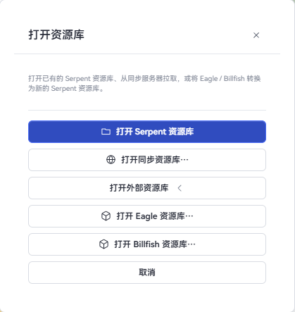
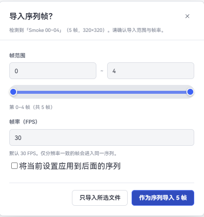
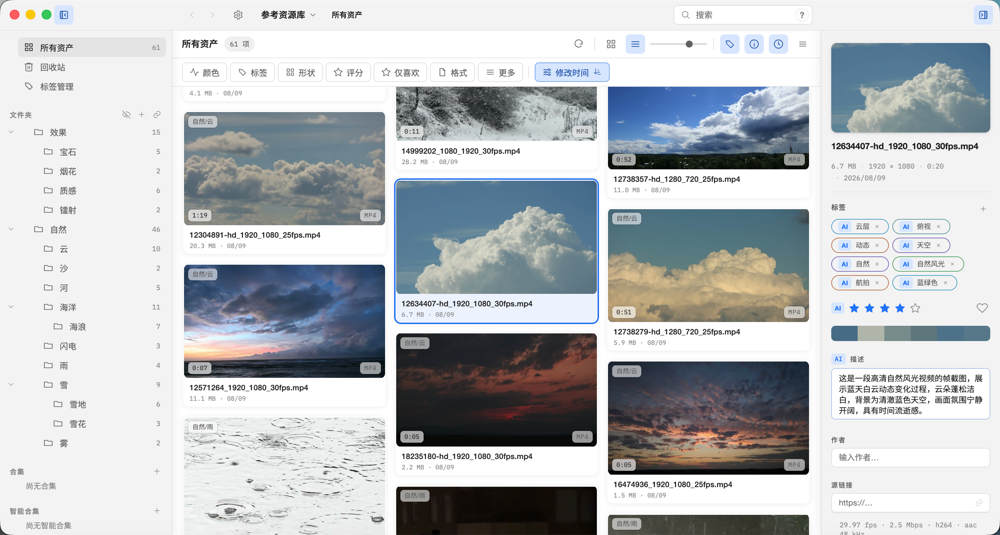
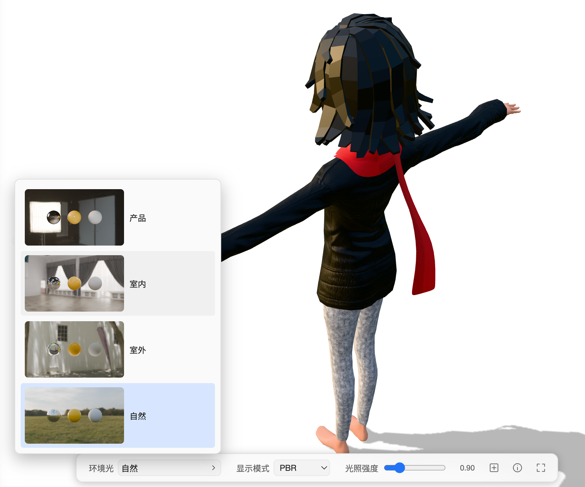

# Basics

## Create, open, and configure a library

On first launch choose **Create library**, pick a location, and enter a display name. A library contains managed assets, its database, and a `.serpent/` working directory. The display name does not move the library directory.

Use the upper-left **Main menu → Library** to create, open, import, or export libraries. **Library settings** lets you rename the current library, see its location, and edit its ignore configuration. A description field is not implemented yet.

The ignore editor uses Git-style rules, one per line; the UI calls it an “ignore configuration file”. Ignore actions for assets, folders, and extensions in this library are written here too. Saving immediately affects browsing, search, and scanning:

```text
# ignore every .tmp file
*.tmp
# ignore this folder
references/drafts/
# keep one file visible
!references/drafts/keep.png
# hide folders whose names start with "."
.*/
```

The `?` help explains `*`, `?`, `**`, a trailing `/` for directories, a leading `/` for library-root rules, and `!` to un-ignore.

### Open external libraries (Eagle / Billfish)

**Open library** → **Open external library…** → choose **Eagle** or **Billfish**:

1. Pick the source library (an Eagle/Billfish library folder or its archive);
2. choose where Serpent should create the local library;
3. Serpent converts the source and creates a local library at the destination (a large Eagle library can take several minutes on first conversion).

After conversion, browsing, search, tags, AI analysis, and everything else work exactly like a local library, and the original files are left untouched.



## Import assets

Drop one or more files, folders, or a mixed selection into Serpent, or use **Import files** / **Import folder**. Folder imports are recursive. The browser extension can save web images and videos from the context menu or by drag-and-drop.

The current product registry includes:

- Images: PNG, JPG/JPEG, GIF, TIFF/TIF, WebP, SVG, BMP, ICO, PSD, EXR, TGA
- Camera RAW: DNG, CR2, CR3, NEF, ARW, RAF, ORF, RW2
- Video: MP4, MOV, AVI, WMV, WebM, MKV, M4V
- Audio: WAV, MP3, OGG/OGA, M4A, AAC, FLAC, Opus (waveform cover plus playback)
- 3D: FBX, OBJ, GLTF, GLB, STL (FBX is converted to a viewable GLB)
- Text: TXT, Markdown, JSON, CSV, XML, YAML, and common source/config formats

Serpent copies managed files into the library and assigns a stable asset ID. Name or content duplicates open a conflict dialog. Thumbnails, technical metadata, and eligible AI analysis are generated in the background, so you can keep browsing immediately.

#### Sequence-frame import

In **Settings → Assets**, turn **Detect image sequences during import** on or off (on by default). When enabled, dropping or importing consecutively numbered, same-size images (for example `00001.png`…`00150.png`) opens the sequence import dialog, where you can set the FPS. When disabled, the files are imported as ordinary images. A sequence appears as one playable asset in the viewer and can be dissolved back into individual frames. Files added or changed in a folder afterwards are not grouped automatically; select them and create an image sequence manually.



In the dialog, adjust the frame range and FPS, then choose whether to import only the current file or the selected frames as a sequence.

## Workspace tabs

Serpent supports multi-tab parallel browsing at the top of the window:


- **Create and switch**: Click the `+` button at the right of the tab bar or use shortcuts `⌘T` (macOS) / `Ctrl+T` (Windows) to open a new tab. Each tab independently maintains its browsing position, search and filter criteria, selections, and scroll viewport.
- **Path hint**: Hovering the mouse over a folder tab displays its full relative path within the library (or disk path for linked folders), helping distinguish same-name subdirectories.
- **Context menu**: Right-click a tab to "Reveal in sidebar" (expands and focuses the item in the sidebar tree), "Copy path", "Reveal in Finder / File Explorer", "Close tab", or "Close other tabs".
- **Closing and shortcuts**: Use `⌘W` / `Ctrl+W` or click `×` on the tab to close it. When only one tab remains, the close button and close menu items are automatically disabled.
- **Session restore**: After quitting and reopening the application, all tabs, their order, and the active tab are automatically restored for each library.

## Custom folder and collection appearance (icons and colors)

Customize icons and color accents for managed library folders, linked folder roots, collections, and smart collections:


- **Setting and clearing**: Right-click a target in the sidebar or tab bar, select **Icons and colors...**, and pick from curated emoji, decorative vector icons, and theme-adapted color swatches; click **Restore default** to revert to standard icons.
- **Consistent appearance**: Custom icons and colors synchronize across the sidebar, workspace tabs, and move/add menus.
- **Linked folder indicators**: Linked folder roots retain linked and offline badges even with custom icons; virtual subdirectories within linked folders do not support custom appearance.
- **Data safety**: Appearance is stored purely as internal library metadata and never renames or moves real folders on disk.

## Folder covers

A folder can use a chosen cover, or return to the automatic one. The library root itself cannot take a cover; managed folders and linked folders can.

- **From the library**: Right-click a folder in the sidebar or on the canvas and choose **Choose cover → From library**. The dialog searches library images by name or path. Select one and choose **Use this cover**.
- **From a file**: **From file** in the same menu picks an image on disk. PNG, JPEG, WebP, GIF, BMP, and TIFF are accepted.
- **From the current image**: Right-click an image asset and choose **Set as folder cover**. Images that sit in the library root, non-image assets, and items in Trash do not offer this command.
- **Restore the default**: When a folder already has a custom cover, the menu includes **Restore default cover**, which returns to the automatic cover.
- The cover is stored in that library and remains after restart. Serpent reports an error when disk space is too low, or when the chosen file is not one of the image types above.

## Browse and organize

- **Sidebar**: All assets, Trash, folders, collections, and smart collections. Click or drag to the empty space at the bottom to return to the library root; use the context menu on managed folders to import linked folders.
- **Canvas**: Supports tile and masonry layouts; use the top toolbar to switch views and toggle visible card fields (filename, size, date, resolution, etc.).
- **Card text alignment**: File name, size/date, and resolution can be left, center, or right aligned. Choose this in **Settings → Browse**, or cycle it with the alignment button on the browse toolbar (left → center → right). The choice is remembered. The default is left.
- **Hover scrub**: Hovering over a video or audio card displays a scrub bar to quickly jump and preview playback.
- **Toolbar**: Search, advanced filters, sorting, and view controls.
- **Inspector**: Displays information, tags, rating, favorite status, description, source URL, technical metadata, and AI analysis results for the selected asset.

Supports marquee selection, `⌘`/`Ctrl` click to add, and `Shift` range selection; press `F2` to rename inline.

- **Cut, copy, and paste**: Select one or more assets, press `Ctrl+X` or `Ctrl+C`, open the destination folder, and press `Ctrl+V`. On macOS use `⌘X`, `⌘C`, and `⌘V`. The asset context menu and main menu offer the same actions. Cut assets are dimmed while their selection outlines remain visible; pasting or copying again restores the appearance. Managed folders also support cut, alone, in batches, or together with assets. Cutting within one library retains folder structure, tags, and asset identities. Pasting a cut selection into its original folder does nothing. Successful cut moves show no import notification; copying creates new assets.
- **Paste files from Windows**: Copy or cut multiple files in File Explorer, then paste in the destination folder in Serpent. Copy retains the source files; cut removes each source after its destination is saved. Skipped files remain in place. A source changed during import is retained with a notification.
- **Rename folders on the canvas**: Select a folder card and press `F2`, or choose **Rename** from its context menu. Edit the name on the card, press `Enter` to save or `Esc` to cancel. The sidebar tree can remain collapsed.




*Settings → Browse switches between grid and masonry views and controls card fields, text alignment, and preview badges.*

## Viewer

Double-click an asset to open the fullscreen viewer (press `Esc` to exit):

- **Navigation**: Use arrow keys `←` / `→` to navigate smoothly between assets in the current view.
- **Media playback & transforms**:
  - Videos and audio play automatically on open;
  - Playback defaults to **Repeat one**. The playback mode button cycles through **Stop after current**, **Repeat one**, and **Sequential**, and remembers the choice. Sequential playback follows the current list order, selects the next video or audio in the same folder, skips other files, and stops after the last item.
  - During fullscreen playback, player controls and the cursor hide after one second without mouse movement. Moving the mouse shows them again;
  - Images and videos can be panned by dragging with the left or middle mouse button;
  - 3D models support mouse drag rotation, zoom, and HDRI lighting switching;
  - The toolbar provides 90° clockwise rotation, horizontal/vertical flip, fit-to-view (numpad `.`), and fullscreen.



## Tags, collections, and smart collections

- **Tags**: Add from the Inspector or context menu, with batch tagging across multiple assets; filter by tags in the search box or filter panel.
- **Collections**: Curate assets across folders (an asset can belong to multiple collections); removing an asset from a collection or deleting a collection never deletes the underlying file. Opening a parent collection lets you toggle whether to include descendant assets.
- **Smart collections**: Save custom search queries and structured filter criteria, automatically displaying matching assets whenever opened; right-click to edit rules.


*With a collection open, the Inspector shows the selected asset's tags, rating, and description.*


*Tag management lists, filters, and creates tags, with a usage count for each one.*

## Trash and deletion

Normal `Delete` / macOS `⌘⌫` moves an asset or folder to Trash. Windows `Shift+Delete` and macOS `⌥⌘Delete` delete from disk after a confirmation. The undo icon in the notification can reverse the most recent undoable file operation and refreshes the current view.

## Linked folders

**Import linked folder** in the **File** menu references a real folder outside the library (such as a project or material directory). Assets are not copied into the library; they are referenced in place in their original folder. You can later copy a linked folder into the library (making it managed), relink it, or set rules for it.

## WebDAV cloud sync

Serpent can sync a library across machines over WebDAV: configure servers globally, bind each library, set auto-sync and the poll interval, and open remote synced libraries. See [Sync and external libraries](sync.md).

## Appearance: New UI

Adjust the interface in **Settings → Appearance**. The switch on the theme row is labeled **New UI**.

- **New UI and the legacy layout**: The switch is on by default and uses the New UI. Turning it off selects the legacy layout. The choice is remembered and still applies on the next launch.
- **Themes**: Use a built-in theme, or edit colors and **Save as new theme**. Light and dark variants are edited separately. Deleting the custom theme that is in use returns the interface to the built-in theme it was based on.
- **Background and opacity**: **App background** sets a background image and adjusts background opacity and panel opacity.
- The same page also has font size, elevation, corner radius, and related appearance controls. They belong to the New UI appearance settings and are not separate features.


*Settings → Appearance holds the New UI switch, light/dark/system mode, built-in themes, accent colors, and custom themes.*

## Launch at login

**Launch at login** in **Settings → General** opens the installed Serpent after you sign in to this computer.

- Installed macOS and Windows builds register Serpent with the system login items.
- If macOS has not allowed it yet, the switch stays on and Settings asks you to enable Serpent under Login Items in System Settings.
- If registration fails, Settings asks you to check Login Items or Startup Apps in system settings, then try again.
- Linux does not offer this yet. Settings shows "This system does not provide launch at login" and does not show a switch.
- An unpackaged development run only remembers the switch. It does not register the current program as a login item.

## Shortcuts

| Action | macOS | Windows |
| --- | --- | --- |
| Toggle fullscreen | ⌃⌘F | F11 |
| New workspace tab | ⌘T | Ctrl+T |
| Close current tab | ⌘W | Ctrl+W |
| Open viewer | Enter / Space | Enter / Space |
| Exit viewer to browse | Esc | Esc |
| Open in external app | ⌘O | Ctrl+O |
| Reveal in file manager | ⌘⇧S | Ctrl+Shift+S |
| Focus search | ⌘F | Ctrl+F |
| Rename | F2 | F2 |
| Move to Trash | ⌘⌫ | Delete |
| Delete from disk | ⌥⌘Delete | Shift+Delete |
| Cut / Copy / Paste | ⌘X / ⌘C / ⌘V | Ctrl+X / Ctrl+C / Ctrl+V |
| Fit viewer | Numpad `.` | Numpad `.` |


*Settings → Shortcuts lets you search actions or keys, rebind them, and review modified or conflicting entries.*

See [Search and filters](search-and-filters.md) for query examples and [AI analysis](ai.md) for AI setup and jobs.
