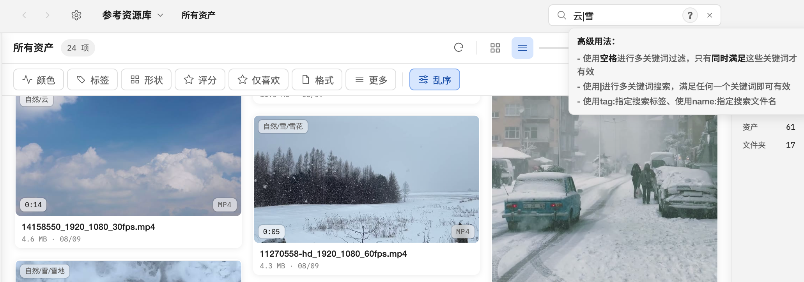

# Search and filters

## Scope and updates

Search runs only in the current browse scope: the current folder/collection, the include-descendants choice, and active structured filters define the candidate set. Typing updates the result after about 200 ms; press Enter to submit immediately. Results load progressively in pages.

Search covers file name, tags, description (including AI description), source URL, author, folder path, and searchable metadata. Plain terms are case-insensitive substring matches. Changes to favorites, ratings, tags, source links, or dimensions remove assets from the results when they no longer match the active filters.

## Advanced query syntax

Hover or keyboard-focus the `?` beside the search field for the in-app reminder. Search and tag conditions share the same combination syntax:

| Syntax | Meaning | Example |
| --- | --- | --- |
| space | AND; every condition must match | `poster blue` |
| `\|` | OR; either condition can match | `poster \| cover` |
| leading `-` | Exclude a condition or a group | `-tag=draft`, `-(tag=draft \| tag=discarded)` |
| double quotes | Keep text containing spaces or special symbols in one term | `name:"hero concept"` |
| parentheses | Group conditions | `(tag=character \| tag=creature) name:hero` |
| `field:value` | Substring match within one field | `author:Jane`, `tag:character` |
| `tag=value` | Match a complete tag name | `tag=character` |

Exclusion is evaluated before AND, and AND before OR. Parentheses change the grouping. `tag:character` can match “character design”; `tag=character` only matches the tag named “character”. The exact form is only for tags; `name=...` and other exact-field forms are not supported.

Field aliases:

- File name: `name:` or `filename:`
- Tags: `tag:` or `tags:`; use `tag=` or `tags=` for complete names
- Description: `desc:` or `description:`
- Source URL: `source:`, `url:`, `link:`, or `source_url:`
- Author: `author:`
- Folder path: `path:`, `folder:`, or `folder_path:`
- Metadata: `meta:`, `metadata:`, or `metadata_text:`

Example:

```text
(tag=character | tag=creature) name:"hero concept" -tag=draft
```

This means “has the character or creature tag, has hero concept in its file name, and does not have the draft tag”. Without a field prefix, all searchable fields are searched. Width, height, long edge, and duration are structured filters, not search operators.

Quote names that contain spaces, `|`, or parentheses, or start with `-`. Inside quotes, write a double quote as `\"` and a backslash as `\\`. An expression allows up to 512 characters, 32 terms, and 8 nested groups. An unclosed quote or parenthesis, or an operator missing a condition, shows an error location while the last valid results remain visible. Fix the expression to update the results.




*Example: `tag:Lighting -tag:Urban` matches substrings in tag names. Use `tag=Lighting -tag=Urban` to match complete names.*

## Filters

Open the **Filters** button beside the search field. Different dimensions combine with AND. Multiple colors, ratings, formats, or shapes combine with OR; tags also support more detailed conditions. Available dimensions include:

- Color: red, orange, yellow, green, cyan, blue, purple, pink, black, white
- Tags: editable combination conditions, or a tag picker with search, top tags, and recent filters
- Shape: landscape/portrait, 16:9, 4:3, 1:1, 3:4, 9:16 presets, plus a custom aspect ratio
- Rating: unrated through five stars
- Format: image, video, audio, 3D, text, and individual extensions
- More: favorite, source URL present/absent, availability (available/missing), long-edge buckets, width, height, and duration ranges

Hold **Shift** while clicking color, rating, format, or shape-preset values to OR-select several values in one dimension. Shift-click an active value again to remove it. A normal click replaces that dimension’s selection; clicking its only selected value clears it. Simple tag selection also supports Shift multi-select, with a choice of matching any or all selected tags. Different dimensions remain ANDed. Boolean and numeric fields in **More** are independent fields, not a list of discrete values.

The bottom of the filter popover repeats “Hold Shift to multi-select”. Active conditions appear as removable chips; **Clear all** resets every filter.

With structured filters active, folders without matching assets are hidden. Sidebar and folder-card counts show the matching totals.


### Tag combination conditions

Enter tag names directly in the tag filter's **Tag condition** field. From simple selection mode, choose **Edit tag condition** first:

```text
(character | creature) -draft
"character design" lighting
```

The first line requires character or creature and excludes draft. The second requires both character design and lighting. Bare names here match complete tags, so character does not match character design. `tag:` and `tag=` also work with the same meaning as in search; other fields belong in the top search box.

Click a suggestion to complete the term at the caret, or right-click it to exclude it. **Choose tags** returns to simple selection. If a complex condition cannot be converted without loss, Serpent asks before clearing it. Ctrl-clicking a tag in the Inspector (⌘-click on macOS) also applies a tag filter.

## Semantic search (experimental)

**Settings → Semantic search** is marked **Experimental**. It finds images and text by meaning, and can look for similar assets. It does not replace keyword search over file names, tags, and the other indexed fields, and it is not AI analysis.

- **Master switch**: Off by default. While it is off, no library uses semantic search.
- **Local model**: Under **Local**, install EmbeddingGemma2. This build uses less space and is the one to install first. The model is downloaded into application data on this computer and is not part of the installer. If this system has no downloadable runtime, use a custom service instead.
- **Custom embedding service**: Under **Custom**, add a service and choose the kinds of content it supports. Vector length can be filled in or left empty; after saving, choose **Test**. The key stays on this computer. Custom services are used for text search for now; finding similar images still uses the local model. A cloud address needs https. Before search text and text files are sent to a remote address, allow that library to send text.
- **Per library**: Open **Library settings → Semantic search**, choose a model for this library, follow the Settings default, or turn it off, then choose **Save**. Another library does not pick up the same choice. Index progress appears on this page or in **Background jobs**.
- **Where the index lives**: The index is stored in that library’s `.serpent/semantic/` directory and stays with the library. Rebuilding clears the saved vectors and processes assets again. A remote service receives the content again.
- **Searching**: After the selected model is ready, the semantic button beside the search field switches between semantic search and keyword search. Right-click an asset and choose **Find similar**. The local model can handle images, audio, and text; to keep analysis time down, semantic search uses a video's cover, not a frame-by-frame analysis. Assets in Trash, and types the current model cannot handle, do not show this command.
- **Batch size**: **Pictures per batch** can be 25, 50, or 100. The default is 50. A change applies starting with the next semantic search.
- Turning this on makes library preparation take longer and uses more memory. Items that are already encoded can be searched first. While the rest are still being encoded, the results may be incomplete.

## Sorting and smart collections

Sort by name, modified time, created time, file size, resolution, duration, rating, color, or author, ascending or descending; shuffle is also available. A search, its filters, and its sort can be saved as a smart collection. Smart collections recalculate when opened, so their results follow library changes.
