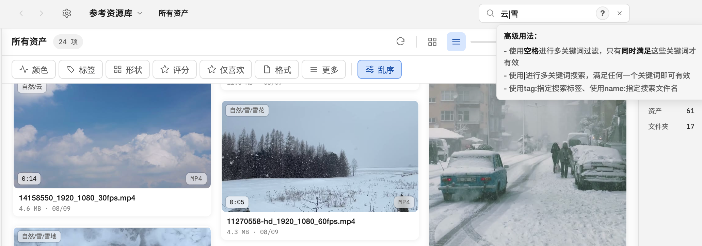
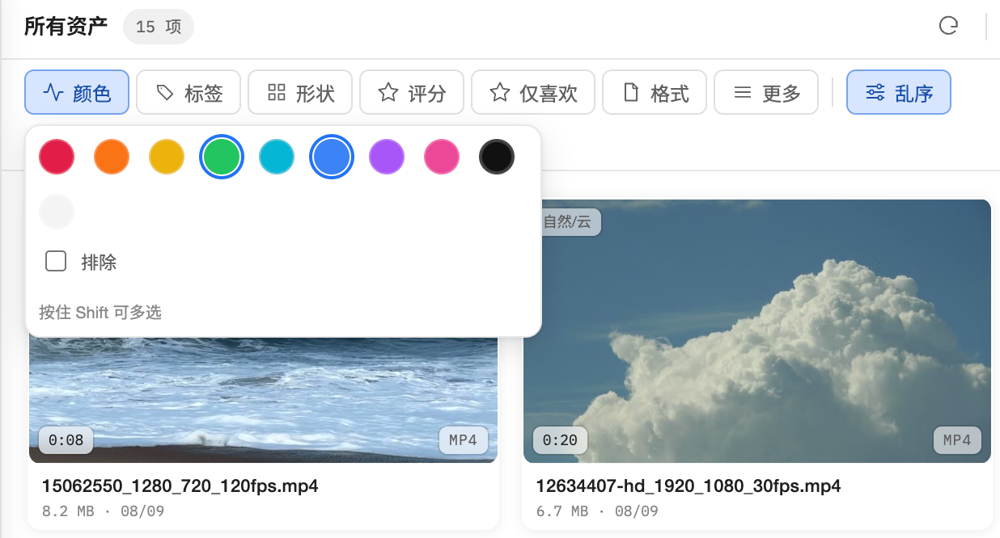

# 搜索与过滤

## 搜索范围和更新

搜索只作用于当前可浏览范围：当前文件夹/合集、是否包含子文件夹或子合集、以及已启用的结构化过滤条件共同决定结果。它不会因为输入关键字而偷偷切换到整个资源库。输入后约 200 ms 自动更新，按 Enter 也可以立即提交；结果按分页渐进加载。

搜索覆盖文件名、标签、描述（包括 AI 描述）、来源 URL、作者、文件夹路径和可检索元数据。普通关键词是大小写不敏感的包含匹配。修改喜欢、评分、标签、来源链接或尺寸等信息后，不再满足当前过滤的资产会从结果中移除。

## 高级搜索语法

悬停或键盘聚焦搜索框右侧的 `?` 可以随时查看提示。搜索和标签条件使用相同的组合语法：

| 写法 | 含义 | 示例 |
| --- | --- | --- |
| 空格 | AND，所有条件都要匹配 | `poster blue` |
| `\|` | OR，任一条件匹配即可 | `poster \| cover` |
| 开头 `-` | 排除一个条件或一组条件 | `-tag=草稿`、`-(tag=草稿 \| tag=废弃)` |
| 双引号 | 把带空格或特殊符号的文字作为一个词项 | `name:"hero concept"` |
| 括号 | 将条件分组 | `(tag=角色 \| tag=生物) name:英雄` |
| `字段:值` | 在指定字段做包含匹配 | `author:Jane`、`tag:角色` |
| `tag=值` | 匹配完整标签名 | `tag=角色` |

排除先于 AND，AND 先于 OR；括号可以改变组合顺序。`tag:角色` 也能匹配「角色设计」，`tag=角色` 只匹配名为「角色」的标签。精确写法只用于标签，不提供 `name=...` 等字段的精确匹配。

支持的字段别名：

- 文件名：`name:`、`filename:`
- 标签：`tag:`、`tags:`；完整名称用 `tag=`、`tags=`
- 描述：`desc:`、`description:`
- 来源 URL：`source:`、`url:`、`link:`、`source_url:`
- 作者：`author:`
- 文件夹路径：`path:`、`folder:`、`folder_path:`
- 元数据：`meta:`、`metadata:`、`metadata_text:`

例如：

```text
(tag=角色 | tag=生物) name:"英雄概念" -tag=草稿
```

这表示“带有角色或生物标签，文件名包含英雄概念，且没有草稿标签”。不写字段时，会在上述可搜索字段中查找。宽度、高度、长边和时长属于结构化过滤，不是搜索运算符。

名称本身含空格、`|`、括号或以 `-` 开头时，用双引号包住；引号内的双引号和反斜杠分别写成 `\"` 和 `\\`。每条表达式最多 512 个字符、32 个词项，括号最多嵌套 8 层。引号或括号未闭合、运算符缺少条件时，界面会提示位置，并继续显示上次有效结果，修正后再更新。




*示例：`tag:光影 -tag:城市` 按标签名包含匹配；要只匹配完整标签名，使用 `tag=光影 -tag=城市`。*

## 过滤

过滤器在搜索框旁的「过滤」按钮中，按维度组织；多个维度同时启用时按 AND 组合。颜色、评分、格式和形状的多个值按 OR 组合；标签还可设置更细的组合条件。当前维度包括：

- 颜色：红、橙、黄、绿、青、蓝、紫、粉、黑、白
- 标签：可编辑组合条件，或切换到标签选择，使用可搜索标签、常用标签和最近筛选
- 形状：横图/竖图、16:9、4:3、1:1、3:4、9:16 等预设，也可填写自定义宽高比
- 评分：未评分到 5 星
- 格式：图像、视频、音频、3D、文本和逐扩展名选择
- 更多：喜欢、是否有来源 URL、可用性（可用/文件丢失）、长边分辨率、宽度、高度和时长范围

同一维度的颜色、评分、格式和形状预设支持按住 **Shift** 点击进行多选；再次 Shift 点击已选值会移除它。普通点击会替换该维度的选择，单击唯一选中值可清除该维度。标签的简单选择模式也支持 Shift 多选，并可选择满足任一或全部标签。不同维度仍然是 AND。更多中的布尔条件和数值范围按各自字段组合，不要把一个范围误当成多个离散值。

过滤面板底部也会显示“按住 Shift 可多选”。启用的条件会显示为可移除的过滤标签，点击「全部清除」可一次清空。

启用结构化过滤后，没有匹配资产的文件夹会隐藏；侧栏和文件夹卡片上的数量显示匹配数。



### 标签组合条件

在标签过滤的「标签条件」输入框中直接写标签名；如果正在使用简单选择模式，先点「编辑标签条件」：

```text
(角色 | 生物) -草稿
"角色 设计" 光影
```

第一行表示带「角色」或「生物」，且没有「草稿」；第二行要求同时带「角色 设计」和「光影」。这里直接写的名称匹配完整标签，不会把「角色设计」当成「角色」。`tag:` 和 `tag=` 也可使用，含义与搜索一致；其他字段需写在顶部搜索框中。

点击建议可补全光标所在词项，右键建议可将它设为排除。点「选择标签」返回简单选择；无法无损转换的复杂条件会先询问是否清空，不会直接丢弃。Inspector 中 `Ctrl` 单击标签（macOS 为 `⌘` 单击）也能应用标签过滤。

## 语义搜索（实验性）

「设置 → 语义搜索」标有「实验性」。它按画面或文字的含义查找，也可以查找相似资产。它不替代按文件名、标签等字段的关键词搜索，也不是 AI 分析。

- **总开关**：默认关闭。关闭后，所有资源库都不使用语义搜索。
- **本机模型**：在「本地」里安装 EmbeddingGemma2。这一档占用更少，适合先用。模型下载到这台电脑的应用数据里，不包含在安装包中。当前系统没有可下载的运行程序时，改用自定义服务。
- **自定义向量服务**：在「自定义」里添加服务，勾选它支持的内容。向量长度可以填写，也可以留空；保存后点「测试」。密钥只保存在本机。自定义服务目前用于文字搜索；按图片找相似仍使用本机模型。云端地址需要 https。搜索词和文本发到远程地址前，需要允许该资源库发送文本。
- **按资源库选择**：打开「资源库设置 → 语义搜索」，可以为这个库选择模型、跟随设置里的默认，或关闭，然后点「保存」。另一个库不会自动套用同一选择。索引进度在这一页或「后台任务」里查看。
- **索引位置**：索引保存在该资源库的 `.serpent/semantic/` 中，随资源库一起保存。重建会清掉已保存的向量并重新处理资产；使用远程服务时会再次发送内容。
- **开始查找**：所选模型可用后，搜索框旁的语义按钮在语义搜索和关键词搜索之间切换。在资产上右键可以选择「找相似」。本机模型可以处理图片、音频和文本；为了减少分析时间，视频的语义搜索使用封面，不会逐帧分析。回收站中的资产，以及当前模型处理不了的类型，不显示这项。
- **每批数量**：「每批显示图片数」可选 25、50 或 100，默认 50。更改从下一次语义搜索起生效。
- 启用后，资源库准备时间会变长，内存占用会增加。已经编码的内容可以先搜索；其余仍在计算时，结果可能还不完整。

## 排序和智能合集

排序可按名称、修改时间、创建时间、文件大小、分辨率、时长、评分、颜色或作者升序/降序，也可选择乱序。搜索词、过滤条件和排序可以保存为智能合集；智能合集打开时重新计算，结果随资产变化而更新。
